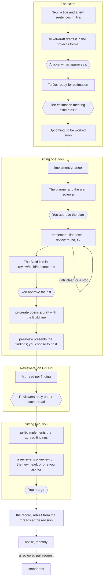

# lasp-dev workflow guide

`lasp-dev` is a Claude Code plugin that takes a ticket to a merged pull request. It drafts the ticket, plans and builds the change, reviews the pull request against a written standard for the repository, and once a month proposes changes to that standard from what reviewers said. A person approves every plan, diff, post and change to a standard. Type `/lasp-dev:quickstart` first; the [README](README.md) is the reference, and the [glossary](#glossary) defines the terms.

## Why

On Libera, the first team to adopt it, the three longest-open `libera_utils` pull requests merged between 2026-06-15 and 2026-09-15 (libera_utils#48, #41 and #27) took 37, 45 and 83 days from open to merge. The most useful review comments were often design questions asked after the code was written, so the plugin asks them on the ticket, builds and reviews against a written standard, and changes the standard from reviewers' replies.

## What it is

- **A written standard for each repository.** Its ledger, `review-rules.md`, lists the rules a reviewer checks, in the repository's own `standards/` or in a project's shared standard that the repository points at. Libera's standard is in `LASP-Libera/libera_standards`, which its repositories point at; [`docs/standards.md`](docs/standards.md) says how a standard records the repositories it covers. A repository's first rules are drafted from its own past review comments; each stays only while people agree with its findings. The planner and every reviewer agent load it.
- **A ticket before the code.** `ticket-draft` checks the change against the project's existing tickets and sizes it, so a duplicate or a split is settled first, then shows the ticket in the team's format and walks its open questions with you, each with a recommended answer. You take the answer or give your own, answer it for now to revisit later, or, when nobody can answer it yet, keep it open, saying why and what it affects; each later step offers to settle it when it has the evidence. A ticket with open questions can still be built, once each is answered. One answered for now moves on as a provisional decision: tagged for further review or design, with why it is not final and what would make it final, since the implementation often answers what the plan could not. One with no answer is researched or discussed with you until you decide it, final or for now; or you settle the ticket first. It travels with the plan, the diff review, the pull request's description and the review, so you and the reviewers know where to come back to.
- **A build with review gates.** The agent plans and you approve the plan. It then builds, running lint, the tests and a round of new reviewer agents sized by the build's depth until they pass or it hits a stop, and shows you the diff.
- **Findings you answer on GitHub.** `pr-review` shows you the findings at their lines, and when you choose to post, posts each as an inline thread. You say whether you agree, disagree and why, or want to discuss, in your own words, on GitHub or through Claude Code. No record is written at review time; the monthly revision rebuilds it from your replies in the threads.
- **A monthly revision.** The driver, a role that rotates, prepares one report from the merged pull requests' threads, proposing which rules to keep, reword, retire or turn into a check. The group decides every change, and `revise apply` drafts what was accepted. When the first one runs is in [ROADMAP](ROADMAP.md), "The first revision".

Copilot and Gemini users get the instruction file and the pull request template; once a repository's ledger holds its rules' wording, they no longer get the review rules, which the plugin loads into Claude Code sessions. The skills run only in Claude Code.

## Setup, once per machine

Follow the README's "Install". The tokens each server needs, and which skill needs which server,
are in the README's "MCP servers". `/lasp-dev:quickstart` checks the setup and gives the fix
for each problem it finds. The plugin does not update itself; see the README's "Updating".

## The flow

`/lasp-dev:work` runs the steps below in order. Give it a ticket key, a pull request or nothing; it reads where the ticket stands and runs the next step. Each step can also be run alone and ends by naming the next command. A large ticket may land as several pull requests in order, each carrying its part and the criteria it claims. Work that spans several tickets starts before the flow, with `/lasp-dev:design-doc` on the page holding your notes: it settles the problem and goals with you, drafts the design doc, and maps the work onto tickets. Once the work lands, `/lasp-dev:architecture-doc revise` brings the system's page up to date, or `/lasp-dev:architecture-doc` writes one for a system that has none. `/lasp-dev:process-doc` does the same for how the team works, a how-to or a user guide.

Figure 1. A ticket from Jira to a merged pull request: the ticket, then the three sittings. Each hexagon is a gate a person holds, the estimation meeting included.

| Step | Command | What the agent does | What it asks of you |
| --- | --- | --- | --- |
| 1. Ticket | `/lasp-dev:ticket-draft` | Checks your description against the project's Jira, reads each repository the change reaches, and drafts the ticket in the team's format, each fact once, with its estimate | Choose how to go on from the placement, answer, keep open or drop each question against the draft, approve it, then approve its write plan, every write to Jira in one numbered list (the ticket or a split's pieces, follow-up tickets and merges, their fields, epic and links, the original text as a comment first), or paste it; `investigate` briefs you on the code and the design choices first, then answers your questions |
| 2. Plan | `/lasp-dev:implement-change <ticket key>` | After the brief, asks whether to plan the change or build it now. A planner drafts the approach, re-checks each of the ticket's design choices, and a plan reviewer challenges it; it sets the depth and brings you the open questions, the ticket's and the planner's, each with a recommendation, and any challenged choice | Decide each open question, decide it for now as a provisional decision with why it is not final, or settle the ticket first; answer any challenged choice; then Approve, Request changes or Let's discuss. No code is written before approval, and the plan file is a draft until then |
| 3. Build | same command, continues | Implements, then loops through lint, the tests and a round of new reviewers until they pass or a stop needs you, then, at standard or deep when it changed code, tightens the passing diff in up to two honing passes. | Read the diff, grouped by plan step, and approve the commit |
| 4. Open the PR | `/lasp-dev:pr-create` | Writes the description from the ticket's decisions and the build's results, within the repository's template, and opens a draft | Say yes |
| 5. Review | `/lasp-dev:pr-review` | Presents the findings at their lines, each with a Proposed line giving the change and its size; drafts comments when you ask, and posts one review with the verdict you choose when you say yes. In a repository without a rules file no finding cites a rule | Decide whether to post; answer each posted finding (next section); the design and science review is yours |
| 6. Fix | `/lasp-dev:pr-fix` | Assesses every thread against the pull request and recommends agree, disagree or discuss; takes your own replies as given, and walks the rest with you, your own comments on your pull request included; plans people's comments ahead of AI findings, and opens the plan review with any place the two disagree; posts your decisions with the fix replies, and on every run links the ones not yet on GitHub, and, when the branch is behind, a rebase; then plans the agreed ones, implements, verifies, pushes and replies | Disposition each thread, approve the plan, the diff, and the push with the replies |

### The estimation meeting

The group estimates the To Do tickets with no Story Points, which a ticket writer moved there once the draft was approved (the project's `tracker.md`, as `using-jira`'s "The project" reads it), and answers what it can of their Open Questions. Then whoever holds the answers runs `ticket-draft settle`, which folds them in and removes those questions, and then writes the ticket to Jira through a write plan, or pastes it. The meeting is one of the turns that settles a question, not the only one, and a question nobody can answer yet may stay open. An epic, or a ticket estimated at 5 or more, is drafted with the group in the room; a simple, well-defined ticket stays with its author.

## Reviewing a pull request

Anyone can run `pr-review`, on their own pull request or anyone's. It shows you the findings in the session first, each at its file and line; drafting comments and posting them each wait on you, and a review you keep local leaves no record. When you post, you choose the verdict, Comment, Request changes or Approve (only Comment on your own pull request), and the pull request gets one review headed **Review** with one thread per finding anchored to the line it is about. Each opens with a severity in words: Must fix before merge, Should fix, Suggestion, or Question. A pull request that did not come through the build is reviewed the same way; its body has no Already checked block, and `pr-review` offers to draft a ticket when it has none. Under each finding a Proposed line gives the change in one sentence and its size; on Agree, that line is what `pr-fix` implements.

Reply under each thread on GitHub, in your own words; only a reply there is read as your verdict. Opening with one of these words is the unambiguous form:

- `Agree`
- `Disagree, <why>`: the monthly revision reads the reason. On a must-fix or should-fix, a
  Disagree without one leaves the finding open until the thread gives one; a suggestion needs
  none.
- `Discuss`: for anything that needs a conversation first.
- A Question takes any answer: your first reply is the answer.

A reply that starts with none of the three words is judged from what it says, so "Good catch,
fix this" is an Agree, and the record marks it judged. One the judge cannot read leaves the
finding open, as Discuss does, until a later reply settles it. The pull request author's first
Agree, or Disagree with its reason, decides, whoever replied before; until they reply, the first
reply stands, and a second person who answers differently leaves it contested for the author. A
finding nobody answers is recorded as unanswered and counts for nothing.

Or run `/lasp-dev:pr-fix` in Claude Code, which assesses each thread, recommends a disposition, walks you through the ones you have not answered, posts your replies if you want them posted, and links any decision you kept local until it is on GitHub.

On your own pull request, review it yourself before a colleague does: read the whole diff on GitHub and leave a comment on each thing to change. You own the change, and your comments are review comments like anyone's: `pr-fix` walks them with the rest, asks how you want to address each, and plans people's comments ahead of the AI findings. A comment that only tells reviewers something, such as why the code is as it is, is answered `Agree, reply only: a note for reviewers, no change`.

Every comment and reply the plugin posts, and the pull request description, ends with an AI assistance level, `5/5` until you lower it when a skill shows you the draft; a design doc carries it as the first row of its Status table. The scale is in `skills/pr-review/comment-style.md`, "AI assistance level".

Keep writing your own review comments: the first rules were drafted from them, and the revision reads them too. Your threads enter the record as pointers, with the author's verdict from the first of their replies that opens with Agree, Disagree or Discuss, or judged from one in their own words.

If the shared standards have something wrong, `/lasp-dev:revise correct` finds every place that carries it, reports them, and drafts the pull request after you choose; a disagreement with a rule goes through Disagree and the revision.

If a skill or agent does something you do not like, `/lasp-dev:skill-feedback` files it as a `skill-feedback` issue on this plugin's repository; what happens to the issue is in the README's ["Changing the tooling"](README.md#changing-the-tooling). It asks what happened, what you did not like and what you would like instead, attaches the session's last turns if you choose, and files nothing until you have seen the whole issue and said yes. `revise` drafts one for each complaint about the plugin it finds in review threads or a correction, under `.review/revision/feedback/`; `/lasp-dev:skill-feedback <draft path>` files it the same way.

## How the rules change

```mermaid
stateDiagram-v2
    [*] --> Candidate : the Recurring ask or Ticket candidates Dial
    Candidate --> Provisional : the Admission Dial
    Provisional --> Established : the Established Dial
    Provisional --> Retired : the Provisional expiry Dial
    Provisional --> Graduated : the revision's judgment; no Dial
    Established --> Graduated : the revision's judgment; no Dial
    Established --> Retired : the Low agree rate or Established expiry Dial
    Graduated --> Archived : its reasoning kept
    Retired --> Archived : its reasoning kept
```

Figure 2. How a rule is admitted and retired. Every transition happens at a revision, with a person agreeing; the labels name the rows of `standards/dials.md`. A graduated rule is enforced by a lint, pre-commit or CI check, and its wording may stay as prose for what the check cannot judge, as R-012's does.

The driver runs `/lasp-dev:revise` before the monthly group meeting, or once ten pull requests have merged since the last report; nothing schedules it. It rebuilds each merged pull request's record, and `thread-analyst` reads every thread, reviewer's summary and conversation comment; with `measures`, it also reads the tickets those pull requests name, the escaped defects and the build yield. The report proposes to keep, reword, retire or graduate each rule and to admit each candidate that meets the Dials, and says which numbers are counted and which are the analyst's reading. It also reports, from a sweep of the window's merged diffs, where the code follows or breaks the rules and the documented practice, and proposes a ticket for a problem still on `main` and a fix for a document the merged work has left behind. It opens with an overview of every proposal by priority and impact; the group takes them in that order, marks each accept, decline or escalate, and leaves the rest blank, deferred. `revise apply` drafts only what was accepted, as reviewed pull requests, the standard's repository first when the standard lives elsewhere, then this repository's `standards/` and documents, and hands each accepted ticket to `ticket-draft` one at a time. The tiers, graduation and the archive are in the README's "How the corpus grows".

A new or reworded rule is first held to `standards/rule-bar.md`, its example resolving in merged code.

### From a review comment to a rule

Three comments from Libera's `libera_utils` reviews, followed to the rule or check each became. Statuses are as libera_utils#94 merged them on 2026-10-06.

**A design question becomes a reviewer rule (R-015).** On libera_utils#12, review asked seven times for a `LiberaDataProductFilename` rather than a bare `str`, and what should happen when the input is an S3 path. On libera_utils#28 the thread chose narrowing the annotation to local paths over rejecting cloud paths at runtime: the merged signature (2c77b27) takes `list[Path]`, and the command line converts each `str` before the call. libera_utils#60 raised the concern a third time. The agent's first draft read *a parameter documents one type, and the annotation narrows to what the code needs*. The second half matched the comments; the first went further than any thread. R-015 now reads *the annotation says what the code actually accepts*. It is established because it implements decision D-007, though no posted finding has cited it yet.

**A recurring request becomes a decision, then a rule (D-008, R-016).** #28 asked for an error aimed at the L2 developers that says what to check and whom to contact. #60 asked the tool to ask for a tag instead of falling back to `latest`. libera_utils#15 asked the logs to name which variables did not match. The decision was first worded *an error message is written for the L2 developer who will read it*, which fit #28 closely and the other two loosely. The concern is now libera_utils decision D-008 and rule R-016, *an error message says what went wrong and what to do next*, established to match the decision.

**A mechanical rule becomes a check (R-012, R-010).** R-012, *the version bump matches the change, and the changelog heading matches it*, came from five pull requests. Nothing about it needs judgment, so since libera_utils#94 the `version-check` pre-commit hook, which CI also runs, enforces it, and the ledger keeps a short entry naming the hook. R-010, *deferred work carries a ticket tag*, was a check from the start: the `prevent-dangling-todos` pre-commit hook already enforced it, so it entered the ledger at the `check` tier and the reviewer never checks it.

**Who decides.** An agent drafts each rule with the threads it came from, so anyone can check that it says no more than they did. After the first standard, a rule enters `review-rules.md` only through `revise apply`, in words the group agreed to at the revision. It starts provisional, with a do-not-flag line that limits its reach; disagreements send it to the next revision.

## What a person always does, and what no agent does

**A person always:**

- approves the ticket `ticket-draft` drafts, approves its write plan before anything reaches Jira, and answers its questions;
- approves the plan;
- approves the diff;
- says yes before a pull request opens, a finding posts, a reply goes out or a design doc publishes;
- sets the AI assistance level on text they have read or edited, which is `5/5` until they do;
- chooses a review's verdict, Comment, Request changes or Approve; `pr-review` recommends one and posts the one chosen;
- answers findings;
- reviews the design and the science;
- merges;
- decides every change to a standard.

**No agent:**

- applies a label, as a reviewer;
- merges;
- writes to Jira or Confluence without showing you the write and getting your yes;
- changes `standards/` other than by a reviewed pull request a person chose;
- posts anything without a person's approval.

Every finding is a proposal. Every count the revision reports is per rule, never per person.

**Automatic, no agent involved.** Each repository's pre-commit on every commit, which in libera_utils, for one, includes the version check; its pull request test lanes on every push; its daily lane.

**Automatic once you start it.** The plan review loop and the build gates run on their own until they pass or hit a stop. How the build ended is always reported as it happened; a run that hit a cap is never called passed.

**Depth.** A build runs light, standard or deep. Light is the implementation reviewer, running lint and the tests that touch the change, beside one focused reviewer, for a change whose every changed line is on the profile's allowlist, such as a changelog entry; standard is the round of reviewers the diff calls for; deep always plans first, with the planner and the plan reviewer, for what the Deep review Dial names. A script sets the floor from the diff; you may raise it, and you may lower a standard floor to light with a reason, which the pull request's `Procedure:` line carries. Deep is never lowered. After the first round, only the implementation reviewer runs again, beside any focused reviewer that had a blocking finding and the tests reviewer when a fix changed a test.

**One session per branch.** Starting a build (`implement-change`) or a fix (`pr-fix`) takes a lock under `.review/`; a second session starting either in the same tree is told who holds it and asks whether to take it over. The skill releases the lock when it finishes or when its session ends, and a lock untouched for four hours, from a session that crashed or was left open, is stale and taken without asking. Reviewing a pull request or drafting a ticket takes none. A session in a repository with a `.review/` directory opens with one line: where the ticket stands and the next command. It never touches GitHub.

**If a session stops partway.** Run `/lasp-dev:work` again; it resumes from the files the phase left behind, and a lock the session left is handled as above.

**Pushing.** `pr-create` and `pr-fix` push a branch only after you say yes, and only where the repository's instructions allow an agent to push. Where they forbid it, as libera_utils' do, both stop at the push, print the command, and go on once you have run it. `revise`, in any of its modes, pushes a branch of the standard's repository when the standard lives elsewhere, after a yes. Nothing else pushes.

## Glossary

- **Standard:** a repository's rules, each with its wording, and its optional decisions, reviewed under the plugin's one contract.
- **Rule:** one entry in `review-rules.md`, kept while people agree with its findings.
- **Check:** a linter, pre-commit or CI check that enforces a rule.
- **Finding:** one thread the review skill posts, citing a rule, decision, term, ticket criterion or test check when one applies, with a Proposed line.
- **Proposed line:** the one-sentence change under a finding, opening with its size. What `pr-fix` implements on Agree.
- **Already checked:** the block at the end of a built pull request's body that says how the build ended and what its gates ran; a pull request written by hand has none.
- **Lock:** one session at a time per working tree while a build or a fix runs.
- **Open Questions:** the section before Related Docs, present only while something is unsettled; each later step offers to settle a question, and a ticket writer may move a ticket with one to To Do.
- **Revision:** the monthly report and meeting that change the rules from the records.
- **Ratchet:** the revision's name in files and scripts: `ratchet-YYYY-MM.md`, `ratchet_counts.py`, `ratchet-proposal.diff`.
- **Context page:** `.review/context/<ticket>.md`, what `ticket-draft` found while drafting, which the planner reads; the paste file for Jira sits beside it as `<ticket>.jira.txt`.
- **Provisional decision:** an answer chosen for now so the work can go on, with why it is not final and what would make it final; each gate and the pull request show it again.
- **Depth:** how much review a build gets, light, standard or deep (see "Depth" above); its allowlist is the profile's `depth.light` entries, the paths and changed lines that may take light.
- **Record:** one merged pull request's findings, replies and verdicts, rebuilt from its threads; `docs/contracts.md` "The record" defines it.
- **Harvest:** the pass that reads merged pull requests' threads into records; when it runs is in the README's "How the corpus grows".
- **Ledger:** a standard's `review-rules.md`, one entry per rule with its tier, status, evidence and wording.
- **Corpus:** the shared files in this plugin's `standards/`: the review contract, terminology, cross-repository decisions, context links, the archive and the records.
- **Dial:** a named threshold in `standards/dials.md`, such as the Admission Dial; the revision applies no number that is not one.
- **Held candidate:** a proposed rule whose evidence does not yet meet the Dials; the revision keeps it and judges it again as evidence accumulates.
- **Rule bar:** `standards/rule-bar.md`, what a new or reworded rule passes before the group marks it, its example resolving in merged code.
- **Driver:** the person who runs the month's revision; the role rotates.
- **Tier:** where a rule is enforced: `prose`, the instruction file only, which the reviewer does not check; `reviewer`, a ledger entry the reviewer checks every diff against; `check`, a tool's configuration, with the ledger entry kept as a pointer (the README's "How the corpus grows").
- **Provisional, established, graduated:** a rule's status on its ledger entry. A rule is admitted provisional, becomes established when the Established Dial is met, and is graduated when the revision judges that a check enforces it; one that leaves is retired.
- **Profile:** one repository's values the skills read, such as its ticket pattern, test and lint commands and depth allowlist, kept in its standard: its own `standards/profile.yaml`, or `profiles/<repo>.yaml` in a standard for several repositories. A key left out is read from the repository's own files, then the plugin's default profile.
- **Sitting:** a stretch of work on a ticket; `work` names three, the author's (plan, build, open and review), the reviewers' on GitHub, and the author's again (fix and reply), as Figure 1 shows.
- **Wave:** one round of reviewers on a build or a fix, the implementation reviewer beside a focused reviewer per focus the diff calls for; `skills/implement-change/reviews/wave.md` defines it.
- **Write plan:** every Jira write a `ticket-draft` or `ticket-audit` pass proposes, shown as one numbered list, approved once with any items dropped, then run in order and read back (`using-jira`, "Writing to Jira").
- **AI assistance level:** the `n/5` on prose a skill composes for a pull request, from 1, written by a person, to 5, not read by one; `5/5` until you lower it (`skills/pr-review/comment-style.md`).
- **Build outcome, Build line:** `.review/build/outcome.md`, which `implement-change` writes when the build loop stops; its first line, `Build: <phrase>`, says how the build ended, and `pr-create` copies it into the Already checked block.
- **`Procedure:` line:** the outcome's and the Already checked block's line of corrections a person made to how the skill or its agents worked, at the plan and diff gates, such as a depth lowered with its reason.
- **Ripple:** a change's reach into the repositories that consume this one; `downstream`'s `Ripple:` line names the consumers predicted, verified by their tests, and broken.
