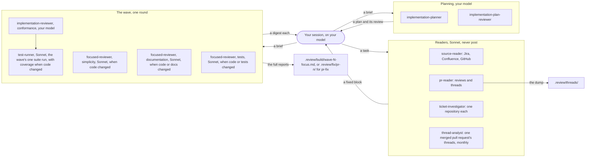

# Design notes

Why `lasp-dev` is built as it is, and what runs beside a session; `GUIDE.md` says how to use it.

## What runs beside your session

Your Claude Code session makes the decisions and asks you; helper agents fetch, draft and review. Each returns a digest or a fixed block, and the wave's reviewers write their full reports to `.review/`, which keeps raw ticket and thread text out of your session. The readers never post or write to Jira, Confluence or GitHub; they write only under `.review/`. The reviewers never edit the change. The README's agents table and its "Models" section are the reference.

Figure 1. Your session sends each group a task or a brief and gets back what it decides on: a fixed block from a reader, a plan and its review, a digest from each reviewer in the wave. The implementation reviewer calls `test-runner`. The rest of the README's agents table is `prose-reviewer`, `github-pr-reviewer`, `github-pr-fix-planner` and `rule-probe`.

## Where things live, and why the package stays slim

A code repository holds its own public-safe standard; in the private `dev-tools`, `standards/` holds the review contract and the records, and a project's standard, which its repositories point at, holds the shared vocabulary and decisions, the context links and the archive; `.review/` holds one working tree's files and is never committed. Each file's home is the README's "How the corpus grows", and `.review/`'s files are its "Layout". Where a project's standards and settings are headed, out of the plugin and into each repository, and why, is `docs/standards.md`.

Nothing in `standards/` ships. The wheel is built from `libera_utils/` alone and the sdist adds only the license, README and `pyproject.toml`, confirmed by a build. In the repository, `standards/` is a handful of markdown files.

The archived record is decisions and pointers, never copies. The revision rebuilds it from the threads; it holds the rule, the location, the verdict and its reason, and refers to the PR thread by id; the thread text stays on GitHub. At our merge rate that is about seven small files a month in the private repository and none in the code repositories.

The same in-repo layout is designed to work for `libera_rad`, `libera_cam` and the project's other repositories, through the project's settings in their shared standard's `profile.yaml` and each repository's own in its `profiles/<repo>.yaml` there; a pointing repository with no such file is refused, not run on defaults. A repository whose own `standards/` sets nothing for it runs on what is detected and the default profile, rather than stopping, and `work`, `quickstart` and the build's Gates line say so, since a default nobody sees reads as the repository's own fact. The default light allowlist is the changelog, the README and `docs/`, not every Markdown file, because in a repository with agent instructions a skill, an agent file or a `CLAUDE.md` is behavior. (`docs/contracts.md`, "The profile".)

A repository with no standard needs nothing written for it: the plugin is upstream of the repositories that use it and names none of them. `profile.py` reads what `survey.py` detects in the repository's own files and history, the ticket pattern its commits use, its test and lint commands, over `standards/default-profile.yaml`, which says how the tools operate (plain posted text, the light allowlist) and nothing a repository or a project states: no Jira workflow and no internal host until a standard records them, so one fact is never kept in two places. Detection is cached per commit in the checkout's git directory, outside the working tree, since a hook asks for the profile at every session start; a configuration file or setting would be one more thing each person must keep right, where the checkout already says which repository it is. A fact detection cannot find, such as the
repository's consumers or its Jira workflow, goes in the repository's own `standards/profile.yaml`,
read as checked out; and a repository whose `standards/profile.yaml` is a `standard:` pointer takes
its settings from the standard that repository holds: the project's from its `profile.yaml`,
stated once, and its own from `profiles/<repo>.yaml`, one level deep (`docs/standards.md`). The
plugin holds no project's settings: an earlier team layer did, and its content moved into
Libera's standard.

## Why it is built this way

**Rules are provisional and share one budget.** A rule is loaded on every reviewer run and has to earn that place, so a rule about `libera_utils` filenaming would be dead weight in `libera_cam`. A rule is admitted provisional and becomes established by the Admission and Established Dials, and retires by the Provisional expiry, Established expiry and Low agree rate Dials (`standards/dials.md`); the rules share one line budget, the Rule budget Dial. (The corpus README, "What lives here, and what does not"; the README, "How the corpus grows".)

**The revision weighs where a rule held, not who said it, and shows what the workflow cost.** A rule's breadth is the number of pull requests in which a finding under it was agreed, whoever wrote the pull request or the reply, not its citation count, which one pull request's repeated threads can inflate. On a team of a few people, requiring agreement from two different authors held back well-founded rules that one person raised and kept agreeing with, and every promotion is the group's mark at the revision, while the Low agree rate, Provisional expiry and Established expiry Dials retire a rule the team does not hold to. A rule ages only by pull requests the rules were run on, a review or a build, so a month of unreviewed merges does not expire it. An AI-drafted thread is never evidence that a person cares, or a model's preferences enter the standard unseen; the adoption sample holds a pull request from before the review bot, found by the bot's first thread, since the instruction files can come months later. A rule two reviewers disagreed about usually has a wrong do-not-flag line, and a rule whose findings go unanswered is noise to its readers, so both are named. The report's head carries open-to-merge time and the pull requests merged without a build beside the proposals, because a month that graduates two rules while the median time to merge doubles has not obviously succeeded, and a workflow people route around is not working. An archive entry quotes every decline reason, the most informative thing anyone writes about a rule. Tickets are read by the pull requests that name them, never by resolution date, since resolution lags the merge and one Jira project can be shared by every repository. The measures no Dial acts on load only on request until a revision shows the meeting uses them. (`skills/revise/prepare.md`; `skills/revise/measures.md`; `skills/onboard/first-rules.md`, "The sample".)

**The revision reads what merged, not only what was said.** A rule's firings come only from findings, so a merged change that breaks a rule nobody flagged, or a documented practice that most pull requests skip, never reached the report. The sweep reads each merged pull request's diff, commits and description against the rules whose `scope:` it touches and the claims the repository's documents make, from git alone, so it runs with no server. It is a sibling of `thread-analyst`, `diff-probe`, rather than more work for it, because it runs on pull requests that had no threads and leaves the analyst's output unchanged; and it is not the full reviewer, which costs too much per pull request. Its results are reported and counted by no Dial until two revisions have shown how often they agree with the group, the same report-first start the probe had. What the sweep and the threads find still in the code becomes a `ticket/` proposal, and a document the merged work has left behind a `doc/` proposal, marked like a rule; an accepted ticket goes to `ticket-draft` one at a time, so Jira is still written only through its write plan. The report opens with an overview of every proposal by priority and impact in place of a fixed cap: a cap hid proposals the group might have wanted, while an ordered list lets the meeting stop when its time is up and leaves the rest blank, deferred. (`skills/revise/prepare.md`, steps 2, 6 and 10; `agents/diff-probe.md`; `skills/revise/apply.md`, step 3.)

**A verdict is what a reply says, read from its word first.** A reply under a finding says Agree, Disagree and a reason, or Discuss. When its first line opens with the word, `scripts/record.py` reads it, for free and the same every time. When it does not, `pr-reader` judges what the reply says, and the record marks the verdict judged with a one-line basis: people answer in their own words, and a marker they must remember to type turned clear agreements into unanswered threads that sent the author back to `pr-fix`. The judge sees only replies with no word after the last word in the thread, and the script refuses a judgment on anything else, so a judgment never overrides a later word, the author's judged reply decides as their word would, and a person who disagrees with a judgment settles it by replying with the word. A reply the judge cannot read stays open and is walked in `pr-fix`; a finding nobody answers is recorded as unanswered and counts for nothing, and a resolved thread is not a verdict. The reason under a Disagree is the one part of a record that cannot be reconstructed later. (`pr-review`, "Whose reply counts"; `docs/contracts.md`, "The judgments".)

**The server's pages are saved by a hook, never written by the model.** A thread dump is every `pull_request_read` result as the server returned it. A result short enough to stay in the model's context has no file to copy, so on the first live harvest the agent wrote each page out by hand: one 40,000-character page needed a repair afterwards, and a safety classifier stopped the agent while it wrote another, ending the harvest at two of nine pull requests. A PostToolUse hook gets the result as the server returned it, so it writes the page and names the file, and the agent only copies it. (`hooks/save-page.sh`; `scripts/save_page.py`; `agents/pr-reader.md`, "The dump".)

**A review is for the person, and posting it is a choice.** `pr-review` stops after presenting the findings at their lines, drafts comments only when asked, and posts only on a yes, with the verdict the person picks: Comment, Request changes or Approve. A review that always posted, always as a Comment, from the author or a reviewer they asked, made the post the purpose and took away a reviewer's own verdict. A review kept local leaves no record for the revision, and that is the person's trade to make. The local file records the choice (`Posting: declined`), so `work` stops sending the person back to a review they already decided on. The pull request's author who answered a findings review, or a thread a person or a bot opened, goes on from the threads after pushing, since answering always moves the head; until they answer one, their own review is offered first, so an unanswered Copilot review does not skip it. A review `work` just posted waits on reviewers even before GitHub shows it in the state, which can lag the post. A reviewer still reviews the new head, and the author asks for a re-review by name, except after a reopen, when the rebuilt design is reviewed again, by the author too, until its thread is answered as fixed. Anyone may run the review again; it says when it is a re-review, and the deduplication by finding key is what keeps a second post from repeating a thread. (`skills/pr-review/re-review.md`, "Re-reviews"; `docs/contracts.md`, "The local review".)

**The author is a reviewer, and people outrank findings.** An author reviewing their own pull request leaves review comments like anyone's, so the record reads a thread they opened in their own words as waiting on their answer, as any other is, and `pr-fix` walks it with the rest; the author only differs in that they also answer. A single model call deciding whether such a comment is an instruction or a note would be one more thing to get wrong, and the walk already asks. A person's comment, the author's or another developer's, is more often about the design than an AI finding, and a finding the author agreed to may have missed the mark, so `pr-fix` plans people's comments first, a person's comment governs where it meets a finding at the design level, and the conflict opens the plan review so the plan is discussed before anything is built. The revision weighs them the same way: the Admission Dial counts the author's own words, and a proposal resting on what people wrote ranks above one resting only on findings' agree rates. (`pr-fix`, steps 5 to 7; `standards/dials.md`.)

**A thread is agreed before it is planned, and the author decides it.** `pr-fix` assesses every thread against the pull request first, what it relates to and whether its claim holds, and recommends a disposition, because a bare Agree, Disagree or Discuss with no context asks the author to reread every thread themselves. The author's own replies on GitHub settle their threads; the rest are walked with them, and only the agreed threads go to the planner. The author's replies count whether they open with the word or are judged from their own words. The dispositions are the verdicts the record keeps, agree, disagree and discuss, with answer for a question: the walk asks how to address each thread, Fix it, Reply only, Decline or Discuss, and posts each as the record's verdict word, Agree, Agree, Disagree or Discuss; move and reopen are kinds of agree and post as Agree. Posting the decisions is optional, since the fix does not depend on them being on GitHub yet. GitHub is still what the revision reads, so each run raises a decision kept local, with a link to its thread, until it is posted; the person may skip it every time. `next_phase.py` does not read the local dispositions (`ROADMAP.md`). A rebase is offered, never run, when the branch is behind: fixing first keeps the review's line numbers, rebasing first fixes against what will merge, and which is better is a judgment call. (`pr-fix`, steps 4 and 5.)

**The why is handed to the description verbatim.** `implement-change` gives `pr-create` the source's own statement of the problem, the agreed goal and criteria, the settled questions, the defects found and the incidental changes, word for word, and `pr-create` judges every time whether it can state the problem, how bad it was and the goal. The plan's steps say how a change is built, not why, so a description written from them explains the mechanics and leaves the reviewer without the goal to judge the diff against. The plan's brief and settled questions count as a source when no skill hands them over; a why drawn only from the build session does not, and `pr-create` asks the person for one. A repository's template is kept, and when it cannot hold the why, `pr-create` says so loudly rather than reshaping the body. (`implement-change` step 11; `pr-create`, "The Why".)

**A page on a system takes its purpose from a person.** `architecture-doc` reads the code for what a system does and what it meets, but code never says why the system exists or for whom, and a purpose inferred from it reads as well as a true one. Every reader builds on that paragraph, so it is drafted from the person's words, shown in prose rather than as options to pick from, and published only after the person's yes to the exact text; it is the one step the skill will not skip, as `design-doc`'s frame is. The interfaces get the second look because they are what another team relies on. The page's sections are a catalog with four required, not a form: a reader of one page finds the purpose and the interfaces in the same place on the next, and past that, a page shaped for its own system reads better than one shaped like the rest. (`skills/architecture-doc/SKILL.md`.)

**A process page takes its steps from people.** `process-doc` writes how something is done, which code rarely shows and a model would fill with how teams usually work. So it holds the same purpose gate as `architecture-doc`, adds whether the page is practice or a proposal, since a reader follows one and debates the other, and settles the steps and who does each with the person before drafting. It reads code only for the commands and options a how-to or guide names. The two skills share what is the same for any page a person reads to learn, `writing`'s `page.md`, and how a published page is revised, `using-confluence`'s "Revising a page", and keep their own steps, since a system and a process are found out differently. (`skills/process-doc/SKILL.md`.)

**A page write carries its macros as storage XML.** The Atlassian server's Markdown writes keep raw `<ac:…>` elements as written, tested on the team's server on 2026-10-25, so a draft stays one Markdown file that a person can diff, and still holds a Jira macro, a mention or an existing draw.io diagram. A write cannot upload an attachment, so a new diagram is drawn as XML and placed by the person once; every write after that keeps it by carrying its macro. Every write also flattens each mention its body does not carry, so a page with mentions is rewritten whole, with each mention re-emitted, rather than a section at a time. (`using-confluence`, "Macros and mentions".)

**A description says each fact once, and length follows the change.** Twelve recent descriptions ran 135 to 1,320 words, and their length tracked how thorough the author was rather than the size of the diff: 396 words for a 25-line change. Most of the excess was a fact told twice, the goal in the why and again as the first item under what changed, the test command under two headings, the ticket's criteria copied into the test table; the rest was test counts CI already shows and file tours the diff already lists. The ticket owns the goal, the scope and the criteria, and the description cites them; the description owns why this diff is built this way and what was decided while building it. No word count is set, for the same reason as the ticket's: changes differ in size. Rules stated as prose barely moved the output in the sandbox; a written audit before the description is shown did: each fact and the sections it appears in, what the first paragraph answers, the change's size and the cuts. On three replayed libera_utils changes, five runs each, it kept every must-keep fact of #96's in all five runs against one of five, and halved #49's 20-line cleanup to about 170 words. (`pr-create`, "Write the Description"; `pr-create/body.md`.)

**Posted text says how much of it a person read.** Every pull request description, review summary, comment and reply the skills post ends with an AI assistance level, as the last sentence of its attribution line. The attribution line says who posted the text, never that anyone reviewed it, so a level below 5 is the only sign of review, and only the person lowers it: a skill grading its own text would produce a number that measures nothing. The level sits inside the line `scripts/record.py` already finds, not on a line of its own, so a verdict reply still reads cleanly. It carries its meaning in words, "5/5 (not read by a person)", because the reader of a public pull request has no copy of the scale and a bare number out of five reads as a grade; the scale itself is defined once, in `comment-style.md`. It is named for assistance, as the attribution line's "AI-assisted" is, so the disclosure uses one term throughout; a higher level means less of a person in the text. A design doc on Confluence has no attribution line, so its level is the first row of its Status table. Commits keep the trailer alone. (`pr-review/comment-style.md`, "AI assistance level"; D-013.)

**The agents that fetch or focus run on Sonnet, and your session decides.** The readers and the wave's focused reviewers fetch or check against a brief rather than make the decisions, so they are pinned to Sonnet, which costs less: a Pro teammate's session is unchanged, and an Opus session pays Opus only for itself and the inheriting agents. Each returns a digest or a fixed block, so your session holds what it decides on rather than the raw material. (The README, "Models".)

**The build's review scales with the change.** Each reviewer in a wave is fresh, so none defends what it said in an earlier wave, and every digest is merged before anything is fixed, so two reviewers pulling against each other are seen together; where they do, conformance to the agreed plan wins. A focus runs only when the diff gives it something to judge: simplicity on changed code, documentation on changed code or docs, tests on changed code or tests, so a test-only change pays for no documentation reviewer. The coverage run is the implementation reviewer's suite run, so a wave runs the suite once rather than twice at once in one working tree, and untested new code is caught when the diff touches no test. A later wave reruns the implementation reviewer and only the focuses that still have a blocking finding, and the tests reviewer when a fix changed a test, since those tests are new to it. A build is light only by the profile's allowlist, its default included, or the person's word, and the floor rechecked over the diff only raises the depth. A removal runs `downstream check`, since libera_utils 5.10.3 removed product identifiers under a patch bump and libera_rad's main went red with no change of its own. A `pr-fix` round writes its wave reports under `.review/fix/pr-<n>/`, since its waves count from 1 again and would otherwise overwrite the finished build's. A standard or deep build that changed code and converges is then tightened in up to two honing passes: a fresh simplicity reviewer reads the whole diff for what keeps the behavior and shortens the code, such as a comment that restates its line or runs longer than its file's, and a fresh implementation reviewer checks what was applied. Honing runs after convergence rather than inside the waves so a fix for a blocking finding never competes with tidying, and a tidy that breaks a test is undone rather than fixed forward. What a comment may say is the review contract's "Comments" section, read by the build's simplicity reviewer and by `pr-review`'s reviewer alike: a session note or an unkeyed follow-up is out of date once the change merges, so it is a should-fix, and later work is one `TODO` line with a ticket key. `comment_scan.py` marks the candidates by pattern before either reviewer reads the diff, rather than a further agent reading the same diff, since a keyless TODO or a phrase like "as requested" needs no judgment to find, only to settle. (`implement-change/reviews/wave.md`; `implement-change` step 8.)

**The ticket comes before the code.** The most useful review comments were often design questions asked after the code was written, so `ticket-draft` asks them first. It asks them against a draft: placement and a rough size come back first, so a duplicate or a split is decided before any question, then the draft with a recommended answer on each Open Question, since walking eight rounds of questions before any ticket text asked the person to hold the ticket in their head. Every question it raises is answered, marked open or dropped by a person; an open one goes to the ticket's Open Questions with why it stays open and what it affects, and every later step offers to settle it. A ticket may keep a question open, since an answer invented to pass a readiness gate is worse than an honest open question; the ticket writer judges readiness when moving it to To Do. The agent never invents a component, an epic key or a link target. No question crosses into the build unanswered, but an answer can be provisional: researched and chosen so the work can go on, and flagged to revisit, with why it is not final and what would make it final, since implementation often answers what planning could not. A provisional decision is shown again at the plan and diff gates, listed in the pull request's description and given to the reviewer as a focus point, since it is where the human review needs to look. Making a decision provisional costs a reason, so the flag keeps its meaning. (`ticket-draft` step 6; `using-jira`, "Never"; `GUIDE.md`, "Why".)

**A skill researches and recommends before it asks; the person decides.** Asking for an answer, a verdict or a mark before anything has read the code asks the person to do that research alone, or to guess. So the planner recommends an answer to each question with its evidence and drafts the plan on it, marking the steps that assume it, so another answer is a visible edit rather than a second plan; `pr-fix`'s assessment recommends a disposition for each thread; and the revision report gives each proposal a `Recommended:` line with the evidence that decides it. A recommendation is never an answer: the plan gate asks with it marked, and the revision's checkboxes stay blank until the group marks them. (`.claude/CLAUDE.md`, "How a skill behaves".)

**The person steers; the sequence is a default.** A skill that runs a fixed sequence leaves the person a passenger, approving each step in turn. So at a natural decision point a skill says where things stand and asks what the person wants to do, the usual next step marked recommended: after the brief, `implement-change` asks whether to plan the change or build it now, since a small change at standard depth does not need a planner run of a quarter of an hour. The gates that stay are the ones before something hard to undo. The shape of a decision point is written once, in a file every asking skill cites, because `.claude/CLAUDE.md` loads only in this repository, and a review of the skills found about twenty widgets, half offering "Let's discuss", four marking a recommendation and several offering no way to stop. The same file says how a skill writes a file, since a heredoc carrying a ticket's markup stops the person at a permission prompt no skill planned. (`.claude/CLAUDE.md`, "How a skill behaves"; `skills/work/decision-points.md`.) What a skill says when a server it needs is missing or failing is written once too, in `skills/work/servers.md`: a review found about twenty skills each wording it their own way, most naming no fix and some stopping with only the error, so a person who had never set a server up could not tell what was lost or what to do. A person whose server is missing meets that message at whichever skill they run first, so it gives the same four things everywhere: which server, what is lost, whether the run goes on, and how to fix it.

**A ticket for three readers, each fact once.** Drafts of the same ticket ran 650 to 1,150 words, and most of the excess was one fact told three or four times: a downstream repository in Used by, Not this ticket, Considerations and an Open Question's options. The ticket is written for the developer, the reviewer and the estimation meeting, each fact once, in the section that owns it; the investigation's detail stays on the `.review/` context page, which `implement-change` reads. In the sandbox this cut two real tickets by a quarter, one from 1,039 words to 746 and the other from 1,043 to 782, three runs each. No word count is set: tickets differ in size, and a fixed number, tried first, cut facts a reader needed to make the number. Two rules ride with it, since sessions disagreed on them: a fact the ticket rests on is re-read in the code and given its line, and a ticket that contradicts the page it cites becomes a question for the person rather than a side the agent picks. (`standards/ticket-format.md`; `ticket-draft` steps 4 and 5.)

**Motivation is the big picture; the survey of the code comes after the scope.** The first ticket the team drafted with the skill opened with Touches, Used by and what the code already does, under Context. Its author read Context as why the ticket exists, and found the survey useful but not what a reader needs first. The section is now Motivation, which names what it holds and no longer shares a name with a pull request body's Context, which describes the code. It says why the work is needed and why now, and what its outcome reaches beyond the code. The why comes from the source or the person, and a source without one is a gap the person answers, with no recommendation and no answer for now, since a motivation the agent wrote would read as the team's. Impact stays beyond the code, leaving consumers to Used by, so the cut in repetition above holds. The survey moves below the scope, as The code today, beside the Considerations the developer reads with it. Each line holds one fact, and a labeled line with more becomes bullets under its label: the same ticket's Impact was one line of four clauses, which its author read as a wall of text. (`standards/ticket-format.md`; `ticket-draft` step 5.)

**Out of scope is a ticket, not a list.** The ticket once placed itself in a Where it fits block, its epic, milestone and neighbors by key, and fenced its scope with Not this ticket, adjacent work as a ticket, a candidate or `not covered`. A second reader of that ticket found the first a copy of what the epic, the due date and the issue links already show, which a copy can only drift from, and the second open-ended, the place a draft gets loose. Both are gone. What other tickets own is Related Out of Scope Tickets, each a ticket linked by its key and summary, so a good summary is what the reader sees; a boundary the change must keep, with no ticket to own it, is a Technical Requirement the reviewer checks; and the documents the ticket cites are Related Docs, linked once. Out-of-scope work no ticket owns becomes a follow-up ticket on one answer: the session already knows enough to file a New ticket with only what it knows, linked to the one it came from, and drafting it properly waits until someone picks it up. Two tickets that ask for the same thing are merged rather than one closed: whatever only the closed one holds, in its description, comments, links and fields, moves onto the kept one first, since a duplicate is often the only place a detail was written down. (`standards/ticket-format.md`; `using-jira`, "A follow-up ticket" and "Merging two tickets"; `ticket-draft` step 6; `ticket-audit`, "Apply".)

**A criterion is an outcome, not a test.** That ticket's criteria each ended in how they would be checked, a unit test with a frozen clock, the existing tests passing, a string to parse, which a second reader found close to implementation and narrower than the rest of the ticket. The section stays, since the planner, the implementation reviewer, the pull request body and `ticket/AC-n` all check the change against it, but a criterion now says only what is true of the product or what a caller sees, and the test that shows it goes to the context page for the planner. A criterion only one implementation would meet is a route, cut to planning or kept as a person's design choice. (`standards/ticket-format.md`; `ticket-draft` step 5.)

**One ticket, written in any tracker's markup; the roles are the plugin's, the statuses the project's.** The ticket format lives in `standards/ticket-format.md`, apart from any tracker, so a ticket drafted for Jira reads the same filed as a GitHub issue, and a team that moves trackers keeps its tickets. The skills route a ticket by five roles, filed, approved, implementation, finished and abandoned, because `work`, `ticket-draft` and `ticket-audit` need one vocabulary to act on; the names a project gives its statuses or labels are its own, and the profile's `issue_tracker` maps them onto the roles. Jira's workflow names every role, so each takes exactly one status. A GitHub repository often has no status labels at all, and an issue's own open and closed states already say filed, finished and abandoned, so each role takes at most one label and a role with none is skipped rather than refused: a repository works with no setup, and one with labels is routed by them. The profile's key was `jira:` while Jira was the only tracker; it is read as `issue_tracker:` with `kind: jira`, so no standard has to change for the new name. (`docs/contracts.md`, "The ticket shape" and "The profile".)

**A format change comes with its migration.** Tickets already drafted hold decided requirements, and redrafting one to change its layout reran the search and the investigators and raised its gaps again. `ticket-draft reformat` maps each old section to its new home, keeps every fact or lists it as removed with its reason, and asks only what the new format needs and the old text cannot give: a missing why, a scope line with no ticket, a criterion that is a route, a link. Its session comment says when no requirement changed, so a reader can trust the rewrite without rereading the ticket. Plain `ticket-draft` offers it before any reader runs on a ticket that is already detailed, whoever wrote it, judged by what the ticket holds rather than by its headings, since the team's tickets follow more than one layout. (`ticket-draft`, `reformat.md`.)

**Design choices in the ticket, implementation on the page.** A ticket says what must be true and the choices that shape it, not how the code does it: a drafting agent's how was a third of a criterion's words (test files, mocking libraries) and most of Technical Requirements (which library, which validator), and none of it was decided by a person. A choice is design-level when someone outside the pull request would notice it change, so a contract, a product format or a technology the team will run stays, with the person or page it came from. The how the investigation found goes to the context page for the planner, who re-checks every design choice and brings a better option to the person rather than taking it, so a choice made at the ticket ("we use Dagster") is a default, not a cage. This departs from the Ticket Management page's template, which asks for implementation details; the team decides which holds (`ROADMAP.md`, Q13). (`standards/ticket-format.md`; `ticket-draft` step 4; `implementation-planner`, "Step 4: Choose an Approach".)

**A status line on the ticket, its history in comments.** A ticket that went through `ticket-draft` opens with one line, rewritten in place, saying when it was drafted and last updated, by whom, and how many questions are open; each pass adds a session comment with what it added, removed, reworded and decided, and each departure of the built work it records. A log in the description would grow with every pass and push Motivation down, and Jira already stamps every comment with its time. The comment also takes What changed off the drafter's machine, where `.review/` kept it, and onto the ticket. The line and the comments name the person because a write carries the name of the account whose token made it, which need not be the person's. (`using-jira`, "Copy-paste output".)

**A departure is recorded beside the ticket, not folded into it.** When review or the build shows the work should leave the ticket's design or criteria, `settle` records the departure as a comment by default, and rewrites the description only when the person says the ticket's intent was wrong. A ticket rewritten to match its code no longer says what was asked, so neither a reviewer nor the revision can see that the work changed course or why. (`ticket-draft`'s `settle.md`, "A departure"; `standards/ticket-format.md`.)

**The original text goes on the ticket before the description changes.** When `ticket-draft` updates a ticket itself, it posts the text the reporter wrote as a comment first and replaces the description only once that comment has landed, so a failure partway can never leave the ticket with neither the old text nor the new. The revision reads that comment as the human baseline, and a posted comment may not be editable or deletable (the account tested could do neither), so the text is converted with the Atlassian server's own converter, copied into the plugin so that any machine with Python runs it, and checked before it is sent. The comment keeps the person's words, URLs and list items and puts their markup right, since the revision reads it for what was asked and which links were pasted, not for its markup, and a raw copy whose markup will not convert stopped the write to ask. Any failure falls back to the paste the skill has always produced, rather than stopping a draft that is otherwise finished.

**One yes for a plan of writes, not one per call.** A split ticket comes to a dozen writes or more: the pieces, their fields and epic, the links between them, the original text and the history. Asking at each call made pasting the easier path for someone whose server can write, so a skill shows every write as one numbered list, a write plan, the person drops what they do not want and says yes once, and the gate hook allows the writes such a plan holds when the main session makes them, since a hook that only stayed silent would leave each call to Claude Code's own prompt. The hook allows a call only when the approval record the skill writes at that yes, `.review/jira-approval.json`, lists that tool on that ticket for this session: an allow also skips Claude Code's own prompt, so one granted to every call of those seven tools would let an unprompted call, or one steered by text in a ticket just read, write with nobody asked. The record names targets because the yes was to those tickets; it carries the session id so a record left in a repository authorizes no other session; and it lapses after 30 minutes, ample for a plan of a dozen calls, so one the skill failed to remove does not linger, while a plan that outruns it only prompts at each call left. A call no record lists is asked about rather than passed silently, because in auto mode a silent hook leaves the call to the classifier, which may approve it unprompted, while a hook's ask still prompts. The record is written by the session, so it narrows what a stray call can do to the tools and tickets a person approved in the last half hour; it does not prove a person typed the yes, and it binds the tool and the ticket, not the call's other arguments, so the text and fields sent are the skill's to keep to the plan. What still asks at the call is what a plan never holds: a delete, a removed link, a move to another project, an edited comment, an upload of local files, any write a subagent makes and anything for Confluence. Confluence has no record: a publish by `design-doc`, `architecture-doc` or `process-doc` is one call and a revise or update a few, so a prompt at each costs little, and a page write that can drop a diagram is worth the second look. Each prompt names the page and the section it writes, so a revise's several prompts can each be matched to the section the gate showed; the gate shows every text it covers in the message that asks, never by pointing back to an earlier turn (`decision-points.md`, "What does not change"). An `ask` rule in a person's own settings still prompts at each call; that is theirs to keep. (`using-jira`, "Writing to Jira"; `skills/using-jira/write-plan.md`.)

**The GitHub issue gate only allows.** A GitHub tracker's plan is gated the same way, by `hooks/issue-gate.sh` and `.review/github-approval.json`, but a call no record lists gets no decision rather than an ask. The same two tools write every issue and comment the plugin makes outside a plan, `skill-feedback`'s filing among them, and people already have their own rules for them; an ask there would add a prompt to calls that had none and change nothing a person chose. The hook therefore narrows nothing: it only removes the per-call prompt for the calls a person approved as a plan, and everything else stays as the person's settings have it. (`skills/using-github/issues.md`.)

**The secret scan stops only what it finds.** `hooks/secret-gate.sh` once asked whenever it could not read a call: a command with an unclosed quote, a repository named by a variable, a message file it could not name, a scan past its time, a server whose kind it could not tell, or a machine with no `python3`. Skills run such commands in their ordinary steps, so the prompt came often, mostly over commands that carried nothing, and a skill-feedback issue (#57) called it a nuisance. A prompt people approve unread protects nothing, and the person stays responsible for what they commit and post, as with any other tool. So what the scan cannot read passes, and the rest of the call is still read: a credential found in the command's text, another commit or another file it sends is denied, naming where and what kind, even when part of the call could not be read. A command it cannot split is judged on its text when it mentions a commit or a `gh` write, since the shell may still run it, and a tool of a server it cannot place as GitHub's or Atlassian's is not scanned. It is a backstop for the commit or post that carries a key by mistake, not a review of every command. (`scripts/secret_scan.py`; the README, "Permissions".)

**The first merge changes nothing for a teammate who does not use the plugin.** The long pull request template, a version check requiring a bump, the measurement narrative and American spelling in libera_utils' pre-commit were kept out of it. The measurement narrative was dropped with the record store.

**The corpus is private, beside public repositories.** `libera_utils` is public, and R-014 keeps internal links and internal document content out of it, while an archive entry says what went wrong, on which mission, and what the team decided. So the archive, the context links and the records live in the private `dev-tools`, and the code repository names its context entries rather than copying them. (The corpus README and the archive README in Libera's standard; R-014.)

**A rule that leaves keeps its reasoning, because the same concern comes back.** Before re-admitting a rule, the revision reads its archive entry: a graduated rule's new evidence points at a gap in its check; a rule retired at a low agree rate, admitted unchanged, repeats an experiment whose result is written down, so the new evidence says what changed; a rule that expired unfired argues for a check straight away. (The README, "How the corpus grows"; the archive README in Libera's standard.)

**A default and an alternative.** Anything a skill can do more than one way has a named default, and the skill takes your alternative without argument: GitHub through the MCP server, or the `gh` CLI when you say so; a ticket or a page from the server, or pasted text or a file when you give one. The skills are for a team whose members already work differently, and people who already use `gh` or paste tickets would otherwise skip the skill. What does not bend is the gates: nothing posts, pushes, or is written to Jira or Confluence without your yes, on any path. (`.claude/CLAUDE.md`, "Conventions"; the README, "MCP servers".)

**A description is read in every session; a rare path is read on that path.** Every skill's and agent's `description:` sits in each session's context whether or not it runs, so it says what only that skill does, the phrases a person types for it, and "Not for" where a sibling or one of Claude Code's `/code-review`, `/simplify` and `/security-review` could be taken for it; an agent no person runs opens "Run by …; not for direct use" and says what it returns. How the skill works belongs in its body. Taking that detail out cut the 32 descriptions from about 2,990 tokens to about 1,700, counted as characters over four. For the same reason a section that only one path reads, a resume, a repository with a standard or a re-review, lives in a file in the skill's directory, which the skill reads on that path; a section the main flow always reads stays. (`implement-change`, "Where the Files Live"; `pr-create`, "In a Repository With a Standard"; `pr-review`, "Re-reviews".)

**The migration is counted per file, and the count only falls.** The plugin becomes mission-agnostic one pull request at a time, so `check_static.py`'s `coupling` check counts, in each generic file, the mentions of a project's names, its Jira key, its internal domain or a Confluence page ID, against `scripts/coupling.json`. It counts mentions rather than lines, so re-wrapping a paragraph changes nothing and a second mention on a line already counted is caught. A total alone would let a pull request add a mention in one file while removing one in another, the new coupling hidden behind the cleanup; a count per file names the file that grew. A count that falls fails too until the baseline is lowered, so a removed mention cannot come back unnoticed, and the update refuses to raise a count, which leaves a raise to a hand edit a reviewer sees. The patterns and the paths left out live in the baseline rather than in the script, so the script names no mission and the count can reach zero. What is left out is content that is Libera's by nature and leaves the plugin whole, such as the corpus's terminology, a directory of it whole so that adding an entry needs no new exclusion, but for the `README.md` that says its entries' format; the plugin's own name is not counted, since it changes once, with the rename. The count covers the shipped plugin files, those under `skills/`, `agents/`, `hooks/`, `scripts/` and `standards/`, which Claude Code loads; `.claude-plugin/` holds the plugin's and its marketplace's names, descriptions, author and homepage, rewritten with the rename, and `docs/`, `sandbox/`, `tests/`, `README.md`, `GUIDE.md` and `.github/` are documentation, fixtures and tests, which move or are rewritten with the scenario packs and the rename, and the count leaves them out. At zero, with nothing left out, any mention in a shipped file fails.

**Where this departs from the design document.** Five places where the plugin differs from the design document of 2026-09-15, and why. That document is kept in the original Libera repository's history, not with the plugin, so its sections are named by number:

| Departure | Why | The design document |
| --- | --- | --- |
| No behavior-contract gate, tests approved before any code | It belongs to a second stage that starts once the first has met its go criteria; the gate before code here is the plan you approve | sections 4 and 14 |
| No bot-written evidence track | A knowledge base that updates itself without a person's ratification turns one agent's guess into team policy; a record here is rebuilt by a script from people's replies, and every change to a standard lands through a reviewed pull request | section 16 |
| No biweekly ratification meeting | Ratification rides on a meeting the team already holds, which guards against its lapsing; the revision is monthly, or once ten pull requests have merged since the last | sections 12.3 and 13.6, the fourth risk |
| No findings posted from CI yet | A reviewer wired to every pull request before its false-positive rate is known teaches a team to scroll past it, and Actions would need an API key in the repository's secrets; whether to post from CI is the team's question (`ROADMAP.md`) | section 12.5 |
| No reviewer agent per tier | One custom reviewer, bound to one review contract, applies every rule, and the rule budget is set at what it can hold (`standards/dials.md`) | sections 5, 7.1 and 13.7 |
